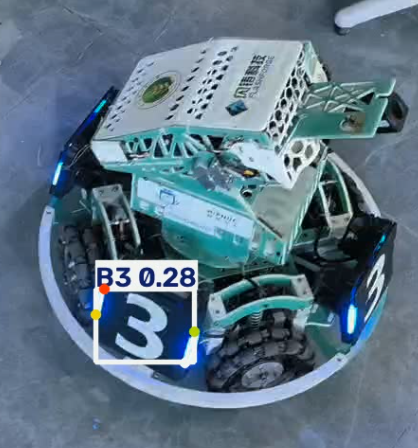

# YOLO 装甲板视频推理

## 1. 项目完成的功能
加载 YOLO 装甲板模型，对拍摄的视频逐帧推理，输出检测框、类别、置信度以及目标的4个关键点，并保存推理结果视频。

## 2. 环境说明
- Python 版本：3.10
- 主要依赖：ultralytics, opencv-python
- 运行设备：CPU

## 3. 模型权重准备
请从课程参考资料中下载 `best.pt`，放置在项目根目录下即可。本仓库通过 .gitignore 排除了权重文件。

## 4. 安装步骤与运行命令
```bash
pip3 install -r requirements.txt
python3 infer.py
```

结果视频保存在根目录 result_video.mp4。

## 5. 视频拍摄信息
拍摄地点：D414 实验室   
拍摄时长：约 15 秒   
场景说明：手机横屏拍摄，包含不同距离和角度的装甲板。

## 6. 结果展示：



----------------------------

# 工业相机装甲板实时识别

## 1. 实验环境
- **操作系统**：Ubuntu 26.04 LTS (VMware 虚拟机)
- **相机型号**：Hikrobot MV-CA016-10UC (序列号: 00L28498186)
- **Python版本**：3.11
- **主要依赖**：Ultralytics, OpenCV, PyTorch (CPU版)
- **模型权重**：YOLO26n 装甲板四关键点模型 (`best.pt`)

## 2. 运行方法
### 依赖安装
```bash
python3.11 -m venv yolo-armor-env
source yolo-armor-env/bin/activate
pip install -r requirements.txt
