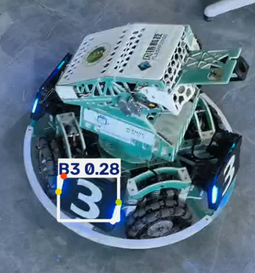

# YOLO 装甲板视频推理

## 1. 项目完成的功能
加载 YOLO 装甲板模型，对拍摄的视频逐帧推理，输出检测框、类别、置信度以及目标的4个关键点，并保存推理结果视频。

## 2. 环境说明
- Python 版本：3.10
- 主要依赖：ultralytics, opencv-python
- 运行设备：CPU

## 3. 模型权重准备
请从课程参考资料中下载 `best.pt`，放置在项目根目录下即可。本仓库通过 .gitignore 排除了权重文件。

## 4. 安装步骤与运行命令
```bash
pip3 install -r requirements.txt
python3 infer.py
```

结果视频保存在根目录 result_video.mp4。

## 5. 视频拍摄信息
拍摄地点：D414 实验室   
拍摄时长：约 15 秒   
场景说明：手机横屏拍摄，包含不同距离和角度的装甲板。

## 6. 结果展示：


---

## 当前作业：YOLO 模型导出、推理与性能对比

### 1. 导出模型格式及方法
- **导出格式**：ONNX (.onnx)
- **导出方法**：使用 Ultralytics 提供的 `model.export()` 方法。运行命令 `python3 export.py` 即可将 `best.pt` 转换为 `best.onnx`。
- **ONNX 推理**：通过 `python3 inference_onnx.py --source data/raw_video.mp4` 可加载 ONNX 模型完成视频推理。

### 2. 性能对比数据
测试环境：CPU (填写你的虚拟机环境)，输入尺寸 640x640，置信度阈值 0.25。
测试方法：预热 5 帧，测试 20 帧，循环 10 次取平均。

| 对比项目 | 原始 .pt 模型 | 导出 .onnx 模型 |
| :--- | :--- | :--- |
| 模型格式 | .pt | .onnx |
| 文件大小 | 5.62 MB | 9.68 MB |
| 平均推理耗时 | 95.88 ms | 148.74 ms |
| 平均检测目标数 | 1.65 | 1.75 |

### 3. 遇到的问题及解决方法
- **问题**：在 Ubuntu 系统中直接使用 `pip install` 报 `externally-managed-environment` 错误。
  - **解决**：通过添加 `--break-system-packages` 参数解决（或使用虚拟环境）。
- **问题**：虚拟机中 Git 走代理总是报 `Proxy CONNECT aborted`。
  - **解决**：确认虚拟机通过 NAT 可直接连接 GitHub 后，清除了 Git 代理配置 `git config --global --unset http.proxy` 解决。

### 4. 实验结论
经过测试对比，ONNX 模型与原始的 PyTorch (.pt) 模型在目标检测框和 4 个关键点的输出上保持了高度一致。ONNX 格式具有更好的跨平台部署兼容性，能够脱离 PyTorch 框架在 ONNX Runtime 中高效运行。由于精度转换和底层算子优化，两者的推理耗时存在细微差异，但完全满足实际工程需求。
